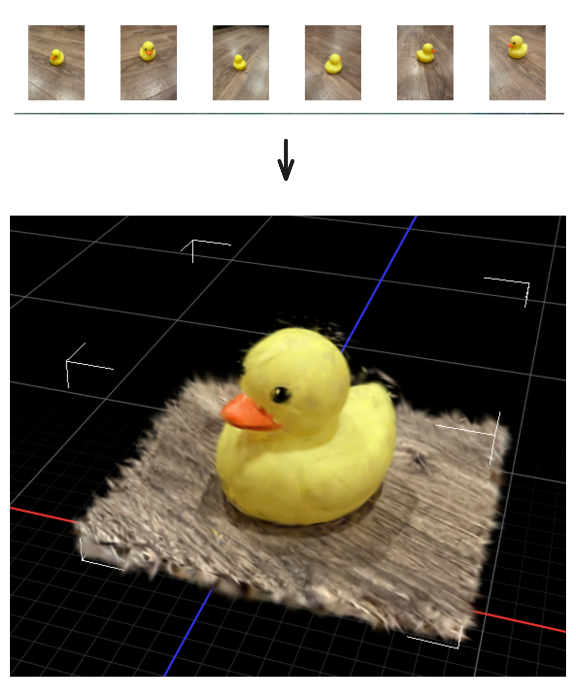

# splatting-rs



3D reconstruction from photos, in Rust, on a Mac. Three crates:

- `mapanything-rs/`: photos → coloured point cloud, with Meta's MapAnything network on
  candle (Metal). One forward pass, no camera poses needed.
- `depthanything3-rs/`: photos → depth maps and cameras, with ByteDance's Depth Anything 3
  Small on candle (Metal). 137 MB of weights instead of 4.9 GB: the browser-sized stage 1.
- `instantsplat-rs/`: photos → Gaussian splat, after InstantSplat. Uses `mapanything-rs` (or
  `depthanything3-rs` with `--network da3-small`) for the points and cameras, then optimises
  Gaussians with its own wgpu/WGSL rasterizer. Its `web/` demo does the whole thing in the
  browser: Depth Anything 3 Small on wasm, the optimisation on WebGPU, no server.

## Setup

A stable Rust toolchain and Xcode's command line tools (Metal). The MapAnything weights
(4.9 GB) download from Hugging Face on first run.

```
cargo build --release
```

## Run

```
cargo run --release -p mapanything-rs -- photo1.jpg photo2.jpg photo3.jpg --out scene.ply
cargo run --release -p instantsplat-rs -- fit photos/*.jpg --out runs/thing
```

`--network da3-small` after `fit` swaps MapAnything for Depth Anything 3 Small. Each crate's
README has the details. Examples: `cargo run --release -p <crate> --example <name>`;
see `mapanything-rs/examples/` and `instantsplat-rs/examples/`.

The browser demo is live at https://antoinemopa.github.io/splatting-rs/. Locally: `npm install`,
`npm run build`, `npm start`, then http://localhost:8787/.
The same page as a desktop window: `cargo run --release -p instantsplat-app` (`instantsplat-rs/app/`).

## Desktop launcher

To open the desktop app from Spotlight, Launchpad or the Dock (macOS):

```
./install-app.sh
```

This installs the app with `cargo install` and adds a `splatting-rs` launcher to
`/Applications` (or `~/Applications`). Rerun it to upgrade.

## Acknowledgements

- [MapAnything](https://github.com/facebookresearch/map-anything) by Meta
- [UniCeption](https://github.com/castacks/UniCeption) by AirLab
- [DINOv2](https://github.com/facebookresearch/dinov2) by Meta
- InstantSplat (Fan et al., 2024, [arXiv:2403.20309](https://arxiv.org/abs/2403.20309)): the recipe
- 3D Gaussian Splatting (Kerbl et al., SIGGRAPH 2023, [paper](https://repo-sam.inria.fr/fungraph/3d-gaussian-splatting/)): the rasterizer maths
- [candle](https://github.com/huggingface/candle) by Hugging Face
- [wgpu](https://github.com/gfx-rs/wgpu)
