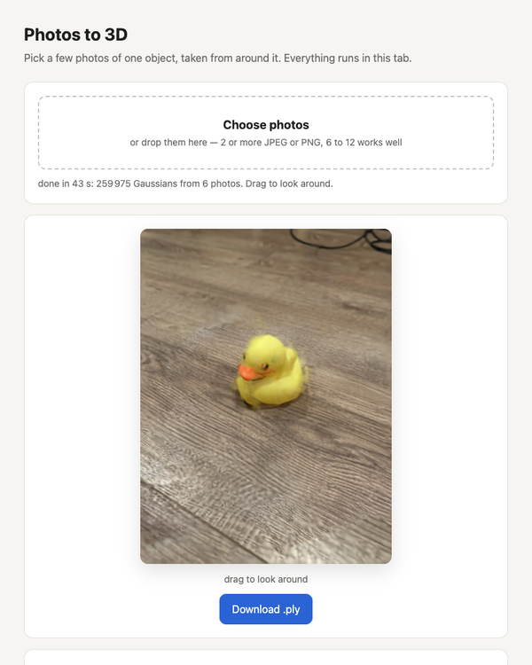

# instantsplat-rs in the browser

Photos in, a trained Gaussian splat out, nothing but the browser: Depth Anything 3 Small
(`../../depthanything3-rs`, 34 M parameters) predicts depth and cameras from the photos
on candle's CPU backend compiled to wasm, one Gaussian per point (`init_from_points`,
stride 2), then the rasterizer and the trainer of `..` optimize them on WebGPU, with the
same WGSL kernels as the native build. Picking photos runs the whole chain, 300 training
steps included; then drag to look around and download `splat.ply`. "Advanced" has the
camera choice, more training and loading a `fit` run.



The network runs in a Web Worker (`worker.js`), so the page stays responsive; it reports
each backbone block. The weights (137 MB, `model.safetensors` of
[depth-anything/DA3-SMALL](https://huggingface.co/depth-anything/DA3-SMALL)) are fetched
from Hugging Face on the first reconstruction and kept in the browser's Cache API, so the
next one starts at once. The focal length comes from the photos' EXIF when present, else
from the network's own prediction.

Measured in headless Chrome on an M5 for the six 3024x4032 duck photos (`.example/`,
inputs at 378x504): weights download 7 s (then cached), preprocessing 0.14 s, Depth
Anything 3 Small 23.5 s on one thread with SIMD (0.75 s per within-view backbone block,
2.3 s per across-views block, 8 s for the depth head), 260 k Gaussians in 0.04 s, training
26 steps/s (300 steps in 11.5 s). Natively the network takes 2 s on Metal.

The page also loads a `fit` run (`splat.ply`, `cameras.json` and the `input_view{i}.png`
it was trained on) from files (under "Advanced") or `?run=<directory URL>`; the example
run is the default scene.

## Build

`rustup target add wasm32-unknown-unknown`, `cargo install wasm-bindgen-cli --version 0.2.129`:

```
cd web
cargo build --release
wasm-bindgen --target web --out-dir pkg ../../target/wasm32-unknown-unknown/release/instantsplat_web.wasm
```

`.cargo/config.toml` turns on `simd128`; `Cargo.toml` patches candle to the upstream commit
that makes its SIMD kernels compile for wasm32 (the native workspace keeps the release).
Serve the crate directory and open the page in Chrome (WebGPU needs `localhost` or https):

```
python3 -m http.server 8787
open http://localhost:8787/
```

## As a site

`build_site.sh` builds everything into `site/` with `example/` (a `fit` run of the six duck
photos) as the default scene:

```
web/build_site.sh
python3 -m http.server -d web/site 8787
open http://localhost:8787/
```

`.github/workflows/pages.yml` at the repository root runs the same script on every push
to `main` and deploys `site/` to GitHub Pages (enable Pages with source "GitHub Actions"
in the repository settings once).

The headless test: `web_da3_shot.mjs` in the Playwright scratch directory loads the page,
picks the photos through the file input, waits for the reconstruction, screenshots the
render, trains and screenshots again; Chrome for Testing needs `--enable-unsafe-webgpu`
and a page served over `localhost` (WebGPU is absent on `about:blank`).
